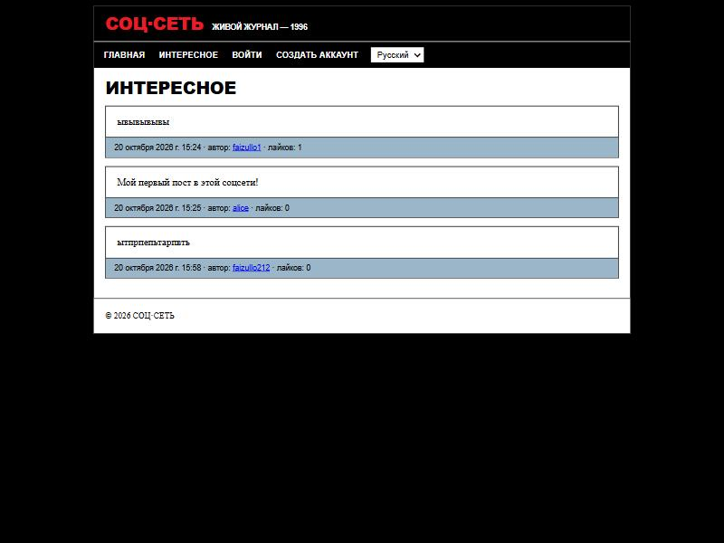
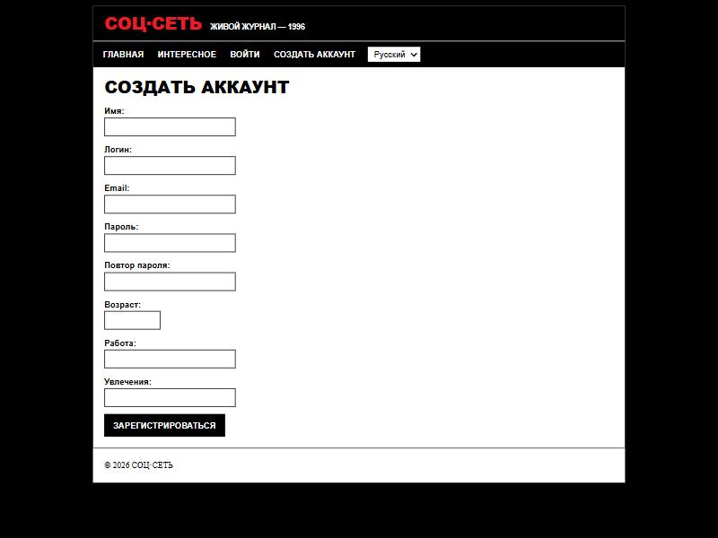

<h1 align="center">СОЦ·СЕТЬ — «живой журнал»</h1>

<p align="center">
  Мини-соцсеть на Django: пользователи регистрируются, ведут личный кабинет,
  публикуют посты и ставят лайки чужим постам.<br>
  Ретро-оформление в стиле <b>Dell (1996)</b>, интерфейс на трёх языках.
</p>

<p align="center">
  
  
  
  
  
</p>

<p align="center">
  
  
</p>

---

## ✨ Возможности

- 🔐 **Регистрация** с валидацией: уникальный логин, пароль ≥ 8 символов и совпадение с подтверждением, корректный email. Ошибки показываются под полями, после успешной регистрации — автоматический вход.
- 🚪 **Вход / выход** через встроенную аутентификацию Django. Пароли хранятся **только в виде хэша**.
- 🏠 **Личный кабинет** (только для владельца): карточка пользователя, публикация постов (не пустой, ≤ 500 символов), стена своих постов с датой и числом лайков, удаление своих постов.
- 🔥 **Лента «Интересное»**: посты всех пользователей, новые сверху, со ссылкой на автора. Открыта без входа; лайкать могут только авторизованные.
- 👤 **Комната гостя** `/user/<логин>/`: карточка и стена постов пользователя. Открытие своего логина перенаправляет в кабинет.
- ❤️ **Лайки**: один лайк на пост от пользователя, повторное нажатие снимает, свои посты лайкать нельзя. Количество лайков считается запросом (`count`), отдельным полем не хранится.
- 🌍 **Переключатель языка** (ru / en / uz) через Django i18n.

## 🎨 Дизайн

Оформление воссоздаёт эстетику сайтов 1996 года по спецификации [**Dell (1996)**](https://github.com/VoltAgent/awesome-design-md) из коллекции *awesome-design-md*: чёрная рамка страницы, красный логотип (`#e91d2a`), заголовки **Arial Black**, текст **Times New Roman**, квадратные углы, рамки 1px, синие подчёркнутые ссылки, без теней и градиентов.

## 🧱 Стек

| Технология | Назначение |
|---|---|
| **Django 6.1** | веб-фреймворк |
| **PostgreSQL** + psycopg 3 | база данных |
| **Django i18n** | локализация ru / en / uz |
| **HTML + CSS** | шаблоны и ретро-стиль (без JS-фреймворков) |

## 🗂️ Структура проекта

Каждая страница вынесена в отдельное приложение, а модели собраны в приложении `blog` (слой данных).

```
progect1/
├── blog/            # слой данных: модели Profile, Post, Like + админка + миграции + utils.py
├── home/            # главная
├── register/        # регистрация (views + forms)
├── login/           # вход / выход
├── cabinet/         # личный кабинет: кабинет, создание и удаление постов (views + forms)
├── interesting/     # общая лента «Интересное»
├── guest/           # комната гостя /user/<логин>/
├── likes/           # постановка и снятие лайка
├── templates/       # общие шаблоны: base.html, _feed_post.html
├── locale/          # переводы ru / en / uz (.po / .mo)
├── static/css/      # style.css — стиль Dell (1996)
├── docs/            # скриншоты для README
├── progect1/        # settings.py, urls.py, wsgi/asgi
├── manage.py
└── requirements.txt
```

Проверка доступа в кабинете сделана **явной проверкой** `request.user.is_authenticated` в начале view (без декоратора `@login_required`).

## 🧩 Модели данных

| Модель | Поля | Связи и правила |
|---|---|---|
| **Profile** | `name`, `age`, `work`, `hobby` | `OneToOneField` к встроенному `User` (логин/email/пароль хранит `User`) |
| **Post** | `text` (≤ 500), `created_at` | `author → User`, сортировка «новые сверху» |
| **Like** | `created_at` | `user → User`, `post → Post`; пара **(user, post) уникальна** |

## 🚀 Запуск

**Требования:** Python 3.12+, запущенный сервер PostgreSQL.

```bash
# 1. Виртуальное окружение
python -m venv .venv
# Windows:
.venv\Scripts\activate
# Linux/macOS:
source .venv/bin/activate

# 2. Зависимости
pip install -r requirements.txt
```

**3. База данных.** Проект (см. `DATABASES` в `progect1/settings.py`) ожидает по умолчанию:

| Параметр | Значение |
|---|---|
| NAME | `postgres` |
| USER | `postgres` |
| PASSWORD | `2123` |
| HOST | `localhost` |
| PORT | `5432` |

Измените эти значения в `settings.py` под свой сервер при необходимости.

```bash
# 4. Миграции
python manage.py migrate

# 5. (необязательно) администратор для /admin/
python manage.py createsuperuser

# 6. Переводы интерфейса
python manage.py compilemessages

# 7. Запуск
python manage.py runserver
```

Открыть: **http://127.0.0.1:8000/**

## 🌍 Локализация

Интерфейс переведён на русский, английский и узбекский. После изменения строк в шаблонах:

```bash
python manage.py makemessages -l en -l ru -l uz   # обновить .po
# ... вписать переводы в locale/<lang>/LC_MESSAGES/django.po ...
python manage.py compilemessages                  # собрать .mo
```

## 🔗 Маршруты

| URL | Назначение |
|---|---|
| `/` | Главная |
| `/registration/` | Регистрация |
| `/login/` · `/logout/` | Вход / выход |
| `/cabinet/` | Личный кабинет |
| `/interesting/` | Лента «Интересное» |
| `/user/<логин>/` | Комната гостя |
| `/post/<id>/like/` | Поставить/снять лайк |
| `/post/<id>/delete/` | Удалить свой пост |
| `/admin/` | Админка Django |

> Адреса содержат языковой префикс (`/ru/`, `/en/`, `/uz/`) — используется `i18n_patterns`.

## 📝 Заметки

- Подписи полей формы входа (`Username` / `Password`) берутся из встроенных переводов Django.
- Тексты постов не переводятся — это пользовательский контент.
- Проект учебный: в `DEBUG = True` и с тестовыми доступами к БД их не стоит использовать в продакшене.
